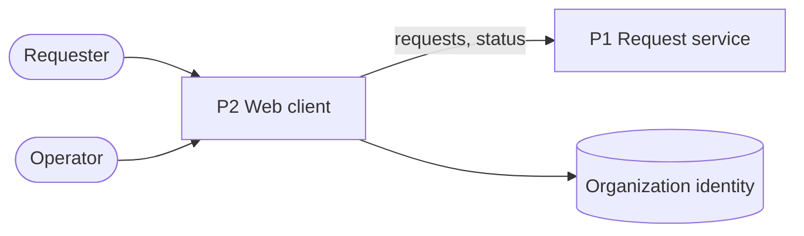
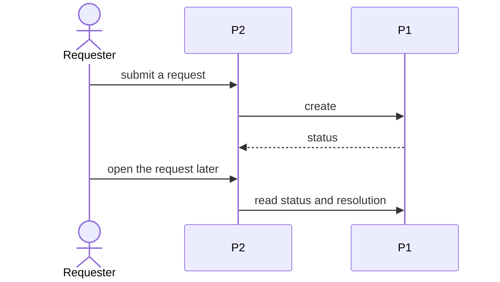

# Request service — architecture

**Inherits**: none

One service owns requests and their status; a web client is where everyone works.

## Shape

Requests and resolutions live only in P1. P1 trusts only the organization provider's tokens.

## Parts

| Part | What it is | Why it exists | Components | Maturity | Spec |
|------|------------|---------------|------------|----------|------|
| P1 Request service | an HTTP service | J-01: one owner of request state (R-01, R-02, Q-01) | API, storage | hypothesis | none yet |
| P2 Web client | pages in the browser | J-01: where requesters and operators work | submit, status, resolve | hypothesis | none yet |

## Core loop

## Key decisions

- **One request service, not a help desk** (D-01): P1 owns requests and their status.

All of them: [decisions](architecture/decisions.md).

## Key areas

| Area | In a line |
|------|-----------|
| Security and privacy | Sign-in is the organization's (C-01); only the requester and operators see a resolution (R-02). |
| Interfaces | Organization identity, for sign-in through P2; an outage is a J-01 variation. |
| Data | Requests and resolutions, owned by P1. |
| Environments | TEST: early access, where a change is tried first; PROD: the whole organization. |

## Risks

- An unstable user id from the identity provider would hide requests from their requester:
  [why it works](architecture/why-it-works.md).

## Left open

- Storage engine, hosting and retention; the first change picks them.
