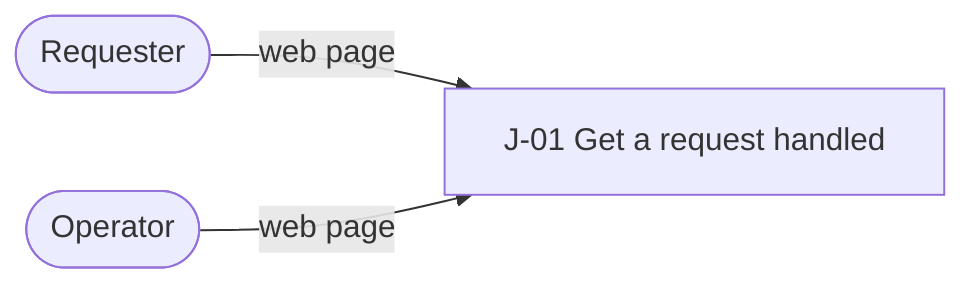

# Request service

Requesters in one organization see their request's status and resolution without chasing an
operator.

**Stage**: Idea · next: MVP ([lifecycle](product/lifecycle.md))

## Problem

Requesters cannot see what happened to a request, so they chase an operator.

| Pain today | Evidence | Solved by |
|------------|----------|-----------|
| No status after submitting | assumed | J-01 |
| Operators answer the same update questions | assumed | J-01 |

This is an illustrative example; no user research or implementation exists.

## Who it is for

| Persona | Wants | Situation | Uses |
|---------|-------|-----------|------|
| Requester | a request handled without chasing anyone | anyone in the organization, at a desk | web page |
| Operator | fewer update questions | the team that resolves requests | web page |

## Journeys

**Core loop**, the journeys the bet depends on:
[J-01 Get a request handled](product/journeys/j-01-get-a-request-handled.md): submit, see
progress, read the resolution, without asking anyone.

| Area | Idea (now) | MVP |
|------|------------|-----|
| Requests | | [J-01](product/journeys/j-01-get-a-request-handled.md) |

## What must be true

- A requester submits once and always sees the current status (R-01, Q-01).
- Only the requester and operators see the resolution (R-02).
- Sign-in is the organization's own (C-01); no routing rules or analytics yet (N-01).

Everything else: [requirements](product/requirements.md), [qualities](product/qualities.md),
[constraints](product/constraints.md), [non-goals](product/non-goals.md). All of them bind every
change; `bounds.sh` lists those in its scope.

## The bet

Requesters who can see status stop asking operators for updates. Wrong if update requests do
not fall after release.

## Waiting on the owner

- Nothing open; operator prioritization is deferred ([inbox](inbox.md)).
