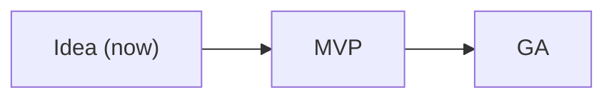

# Request service — lifecycle

**Now**: Idea · **Next**: MVP

## Idea (now)

- **Goal**: agree the problem and the bet before building.
- **Audience**: the owner.
- **Environment**: none; nothing is built.
- **Promise**: none.
- **Exit when**: the owner confirms the journey and the bet.

## MVP

- **Goal**: one team's operators and requesters use J-01 for real requests.
- **Audience**: one team.
- **Environment**: TEST, with real requests.
- **Promise**: best effort; Q-01 measured, not yet enforced.
- **Exit when**: update requests to operators fall; the owner decides.

## GA

- **Goal**: every team in the organization.
- **Audience**: anyone in the organization.
- **Environment**: PROD.
- **Promise**: supported; Q-01 enforced.
- **Exit when**: not planned.
