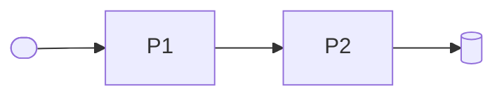
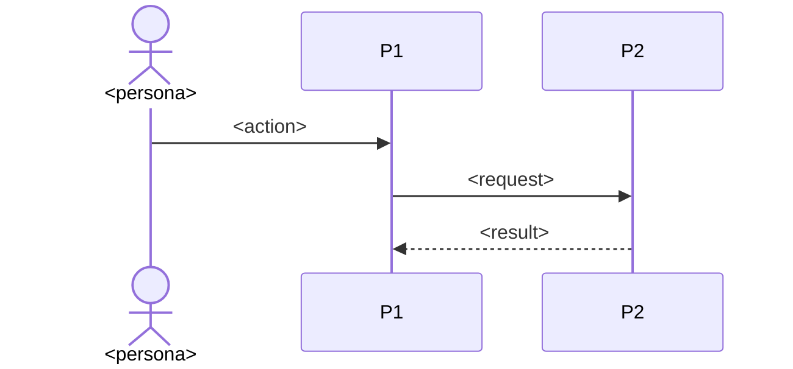

# <Product> — architecture

**Inherits**: <platform document (`org/repo`, path) and the rules used> or none

<One sentence: the shape of the system and why it fits the core loop.>

<!-- The overview, read at a glance: one screen. Detail lives in specs/architecture/<topic>.md
(architecture-topics-template.md) and specs/parts/. A topic with little to say stays a short
section here until this page passes its budget. -->

## Shape

<A few lines: where data lives and where the trust boundaries are.>

## Parts

| Part | What it is | Why it exists | Components | Maturity | Spec |
|------|------------|---------------|------------|----------|------|
| P1 <name> | <runs or ships where> | J-01, R-01 | <components> | hypothesis | [p1-<slug>](parts/p1-<slug>.md) |

## Core loop

## Key decisions

- **<title>** (D-01): <the choice in a line, and what it rules out>.

<!-- The five to seven that shape everything; all of them: [decisions](architecture/decisions.md). -->

## Key areas

| Area | In a line | Detail |
|------|-----------|--------|
| Security and privacy | <trust boundaries, identity, encryption, personal data> | [security](architecture/security.md) |
| Observability and live site | <what is watched, who is alerted, how incidents run> | [observability](architecture/observability.md) |
| Data | <what is stored where, kept how long> | [data](architecture/data.md) |
| Interfaces | <the promises between parts and to external systems> | [interfaces](architecture/interfaces.md) |
| Environments | <each environment, what it is for, where it is provisioned> | [environments](architecture/environments.md) |
| Operations | <delivery, tooling> | [operations](architecture/operations.md) |

## Risks

- <The riskiest assumption, what breaks if it is wrong, and the check:
  [why it works](architecture/why-it-works.md).>

## Left open

- <L1 decisions intentionally not made; agents choose them without asking.>

<!-- When a part goes or an ID moves, list it under `## Retired` in specs/architecture/retired.md
and link it here:
- P<n> <name>: retired: <where it went>.
- **P<n>.B-NN <title>**: retired: now P<m>.B-NN.
-->
