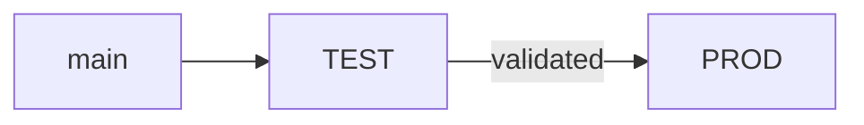

# Architecture topics

<!-- Each topic is its own file, specs/architecture/<topic>.md, opening with
`# <Product> — <topic>`. Copy the skeleton below; create a topic only when it has content, and
link it from architecture.md's Key areas. Past its budget a topic splits into
architecture/<topic>/<area>.md, one line and a link each. Decisions use decision-template.md. -->

## security.md

- **Trust boundaries**: <where they are, and what crosses each>.
- **Identity and access**: <who signs in how; which roles see what>.
- **Encryption**: <in transit, at rest, who holds keys; what it does not protect>.
- **Personal data**: <categories, legal basis, rights, cited C- and R-; detail in data.md>.

## observability.md

- **Signals**: <what is measured per part, and the Q- it watches>.
- **Alerts**: <what wakes whom, and the threshold band>.
- **Live site**: <how an incident is noticed, handled and closed; where its record lives>.

## data.md

| Data | Owner part | Lives in | Kept for | Removed by |
|------|------------|----------|----------|------------|

## interfaces.md

| Interface | Owner part | Consumers | Promise | Schema in code |
|-----------|------------|-----------|---------|----------------|

| External system | Used for | By | When it fails |
|-----------------|----------|----|---------------|

## why-it-works.md

### <Claim, citing J, R or Q>

- **Mechanism**: <how the parts achieve it>
- **Assumptions**: <what must hold; link observed facts>
- **Alternatives**: <option — why rejected>; include a managed or off-the-shelf option
- **Revisit when**: <condition>

## environments.md

<!-- Where the product runs. Each stage names its environment in product/lifecycle.md; one
environment can serve several stages and outlast them: early access keeps taking new features
first once production opens. The first cell is the name alone, spelled as stages spell it. -->

| Environment | For | Provisioned in | Data | Who reaches it | A release gets there |
|-------------|-----|----------------|------|----------------|----------------------|
| <TEST> | <early access: new features tried and validated first> | <its own account, subscription or project> | <sample, then invited users' real data> | <owner, invited testers> | <each merge to main> |
| <PROD> | <the product for everyone> | <a dedicated account, subscription or project; or TEST's at first, for a small product> | <real data> | <anyone> | <a release validated in TEST> |

- **Isolation**: <what they never share: data, secrets, identities; accounts once separate>.
- **Data between environments**: <never moves, or only by its owner's action after a summary>.

## operations.md

- **Delivery**: <build, test, deploy to each environment, roll back>.
- <Tool or job>: <what it does, who runs it>. Code: <path>.
