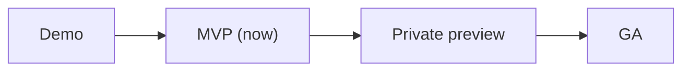

# <Product> — lifecycle

**Now**: <stage> since <date> · **Next**: <stage>

<!-- Stages, in order: Idea, Demo, MVP, Private preview, Public preview, GA, Sunset, Retired; skip
those the product does not need. Only the owner moves Now, when the exit criteria pass. An item
needed only from a later stage carries `from: <stage>` with its maturity, for example
`**R-12 Choose a plan** (hypothesis, from: ga)`; without one it is needed now. Remove a marker
once its stage is reached. Each stage's Environment names one from
architecture/environments.md; a common split is early access (TEST) up to Private preview and
production (PROD) from Public preview on. Past the budget, a stage moves to
lifecycle/<stage>.md; Now, Next and one line and a link per stage stay here. -->

## <Stage> (now)

- **Goal**: <what this stage proves, and for whom>.
- **Audience**: <who uses it: the owner, invited testers, anyone>.
- **Environment**: <the environment it runs in (architecture/environments.md); sample or real data>.
- **Promise**: <support, the quality bands enforced, compatibility>.
- **Exit when**: <observable criteria>; the owner decides.

## <Next stage>

- **Goal**: <...>.
- **Audience**: <...>.
- **Environment**: <...>.
- **Promise**: <...>.
- **Exit when**: <...>.
