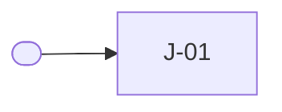

# <Product>

<One sentence: what it is, for whom, and what changes for them.>

**Stage**: <now> · next: <stage> ([lifecycle](product/lifecycle.md))

<!-- The executive page, read at a glance: one screen. Detail lives in specs/product/. Name
roles, never people. Past the budget, keep the main pains and personas here and move all of
them to specs/product/users.md, linked. -->

## Problem

<One sentence: who struggles with what today.>

| Pain today | Evidence | Solved by |
|------------|----------|-----------|
| <what goes wrong, from their side> | <assumed, desk research, observed or measured; a link> | J-01 |

<!-- Every journey solves a pain or supports one that does. A pain no journey solves is a gap;
a journey that solves none is a question for the owner. -->

<!-- About a dozen nodes at most: past that, draw personas, surfaces and areas, not journeys. -->

## Who it is for

| Persona | Wants | Situation | Uses |
|---------|-------|-----------|------|
| <a real target user> | <their goal> | <where, when, what limits them> | <surfaces> |

Not personas: <whoever tests, deploys or hosts it, each with where it belongs: a constraint,
Operations or a requirement>.

## Journeys

**Core loop**, the journeys the bet depends on:
[J-01 <journey>](product/journeys/j-01-<slug>.md) → [J-02 <journey>](product/journeys/j-02-<slug>.md)

| Area | <Now stage> (now) | <Next stage> | <Later stage> |
|------|-----------------|--------------|---------------|
| <area> | [J-01 <journey>](product/journeys/j-01-<slug>.md) | [J-03 <journey>](product/journeys/j-03-<slug>.md) | |

<!-- A journey sits in the column of the stage it is needed from: its file's `from:` marker, or
the current stage without one. -->

## What must be true

- <Five to seven of the most important items in a line each, with their IDs.>

Everything else: [requirements](product/requirements.md), [qualities](product/qualities.md),
[constraints](product/constraints.md), [non-goals](product/non-goals.md). All of them bind every
change; `bounds.sh` lists those in its scope.

## The bet

<The thesis, and the signal that would prove it wrong.>

## Waiting on the owner

- <The few open decisions that matter most, linked to the [inbox](inbox.md).>
